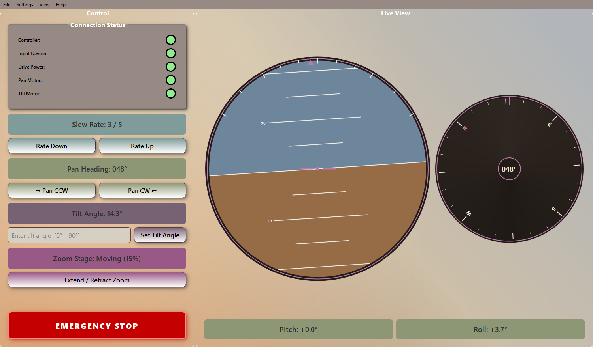

# Pan-Tilt Gimbal Control Console

A desktop operator console for a **two-axis camera platform**, built with Python and
PyQt6. It presents everything an operator needs in a single glance-able panel: live
attitude instruments, pan / tilt / zoom command dispatch, per-subsystem connection
monitoring, and a latching emergency stop.

> This is a simulated stand-in for professional work I can't share publicly. It reuses
> the same design patterns and interface techniques, applied to a neutral example and
> wired to a software simulator instead of real hardware.

The whole console runs against the built-in **software simulator**, so there is no
hardware required. Launch it and the platform comes online, the artificial horizon
starts moving, and every control is live.



---

## Features

| Area | What it does |
|---|---|
| **Artificial horizon** | A from-scratch `QPainter` attitude indicator shows live pitch and roll with a pitch ladder and roll scale. No image assets. |
| **Heading compass** | A rotating compass card tracks the pan axis with a digital heading readout. |
| **Slew-rate control** | A 0 to 5 "gear" that scales how fast the pan and tilt axes move. |
| **Pan control** | Momentary CCW / CW jog. The axis moves only while the button is held. |
| **Tilt control** | Type a target angle (0° to 90°) and the axis eases to it at the current slew rate. |
| **Zoom stage** | Extend / retract a motorized zoom stage with a live position percentage. |
| **Connection status** | Five subsystems report online/offline; offline LEDs blink so faults are obvious. |
| **Emergency stop** | A latching E-STOP freezes all motion and flashes a banner until reset. |

## Architecture

```
gimbal_console.py   PyQt6 GUI: window, menus, controls, live update loop
widgets.py          Custom-painted instruments (attitude indicator, compass)
simulator.py        Software model of the gimbal: telemetry + command response
```

The GUI never talks to hardware directly; it polls `GimbalSimulator.step()` on a
20 Hz timer and reads back state. Swapping the simulator for a real serial / fieldbus
backend would mean implementing the same small method surface
(`connect`, `set_tilt_angle`, `nudge_pan`, `toggle_zoom`, `engage_estop`, `step`, …).

## Run it

```bash
pip install -r requirements.txt
python gimbal_console.py
```

### Keyboard shortcuts

| Key | Action |
|---|---|
| `F1` | Connect all subsystems |
| `F2` | Disconnect all subsystems |
| `F5` | About |
| `F9` | Reset view |
| `F11` | Toggle fullscreen |

### Developer flags

```bash
python gimbal_console.py --selftest             # headless smoke test, exits 0
python gimbal_console.py --screenshot out.png   # render a screenshot and exit
```

## Tech

Python · PyQt6 · custom `QPainter` instrumentation · timer-driven real-time UI.
